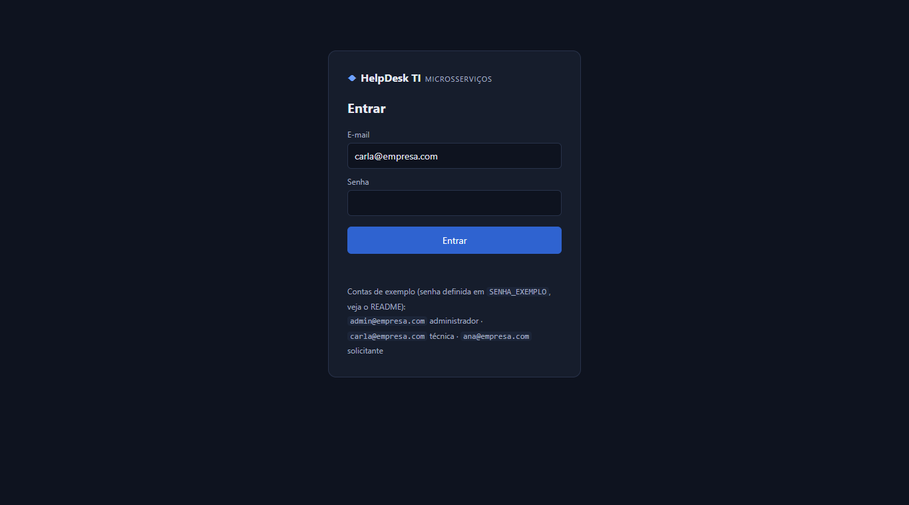
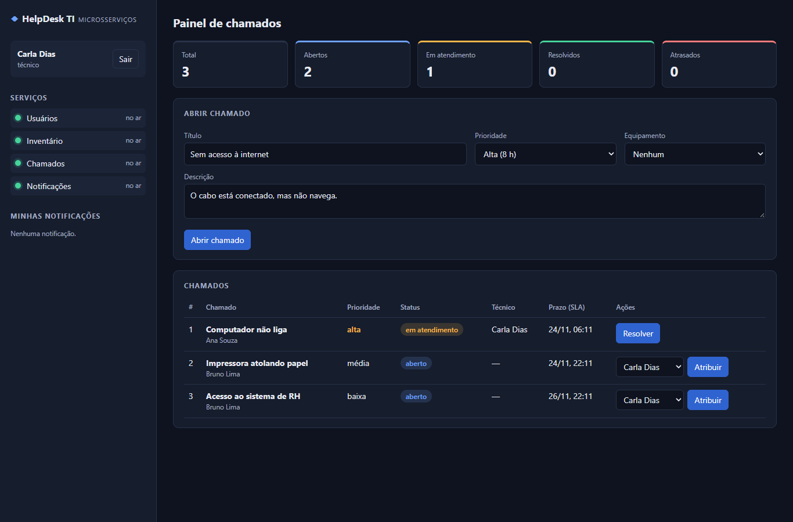
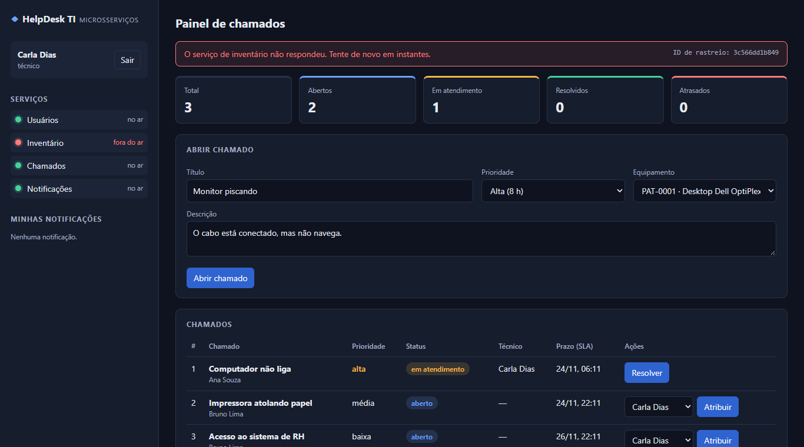
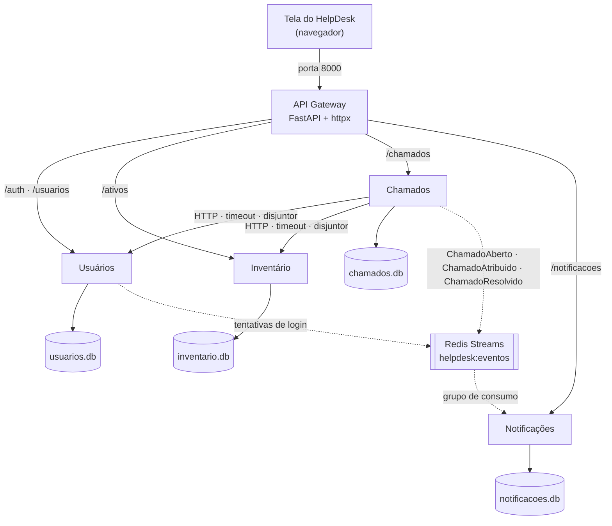
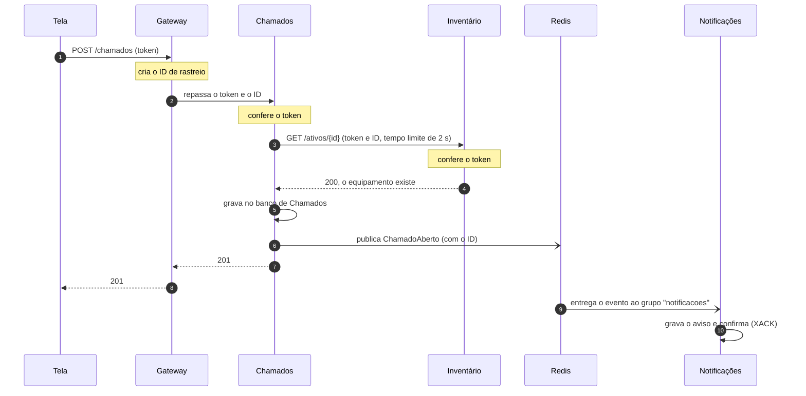

# HelpDesk TI · microsserviços

> 🎬 **Vídeo de demonstração:** [assistir no Google Drive](https://drive.google.com/file/d/14Ge2GdaxhYFKY-lhMgA317d_03okGu_9/view?usp=sharing) (4 min 30 s)

Sistema de chamados de TI, transformado de **monólito** em **microsserviços**: um gateway, quatro
serviços com banco próprio e uma fila de eventos, tudo subindo com um comando. É a resposta ao
[desafio da disciplina de Arquitetura de Software](DESAFIO.md); o código de partida é o monólito
do Prof. Filipe Cavalcante (os três primeiros commits deste repositório).

| Entrada | Painel do técnico | Inventário fora do ar |
|---|---|---|
|  |  |  |

## Arquitetura



As linhas cheias são chamadas HTTP, que esperam a resposta. As tracejadas passam pelo Redis: quem
publica não espera ninguém.

**Abrir um chamado com equipamento**, do clique ao aviso:



| Serviço | Faz | Banco | Fala com |
|---|---|---|---|
| **Gateway** | serve a tela, encaminha cada rota pelo começo do caminho, cria o ID de rastreio, mostra a saúde de todos | — | todos, por HTTP |
| **Usuários** | cadastro, login e emissão do token | `usuarios.db` | Redis (limite de login) |
| **Inventário** | equipamentos | `inventario.db` | ninguém |
| **Chamados** | o fluxo do chamado, com as regras de SLA e de status | `chamados.db` | Usuários e Inventário (HTTP); Redis (eventos) |
| **Notificações** | lê os eventos e guarda os avisos de cada usuário | `notificacoes.db` | Redis (eventos) |

## Como rodar

```bash
docker compose up --build
```

Abra **http://localhost:8000** e entre com uma das contas (senha `Helpdesk2026`):

| E-mail | Perfil |
|---|---|
| `carla@empresa.com` · `diego@empresa.com` | Técnico: vê tudo, atribui e resolve |
| `ana@empresa.com` · `bruno@empresa.com` | Solicitante: abre e vê só os próprios chamados |
| `admin@empresa.com` | Administrador: tudo, inclusive cadastrar usuários |

- **Nada a configurar.** Sem `.env`, o contêiner `segredo` gera o segredo dos tokens na primeira subida
  e o guarda num volume que só os serviços leem. Para usar o seu, copie `.env.example` para `.env`.
- **Começar do zero:** `docker compose down -v` apaga os volumes; na próxima subida, os bancos voltam
  só com os dados de exemplo.
- **Testes:** `pip install -r requirements-dev.txt` e `pytest -q` (94 testes; também rodam no GitHub
  Actions a cada envio, com o `pip-audit` conferindo as dependências de cada serviço).

### Ver funcionando pelo terminal

| O quê | Comando |
|---|---|
| Os contêineres no ar | `docker compose ps` |
| Só o gateway tem porta para fora | na coluna `PORTS`, só ele mostra `127.0.0.1:8000->8000` |
| Uma chamada sem token | `curl -i http://localhost:8000/chamados` → `401` |
| A saúde de cada serviço | `curl http://localhost:8000/saude` |
| Um banco por serviço | `docker volume ls` → `banco-usuarios`, `banco-inventario`, `banco-chamados`, `banco-notificacoes` |
| Derrubar e religar o Inventário | `docker compose stop inventario` · `docker compose start inventario` |
| Seguir um pedido por todos os serviços | `docker compose logs \| grep <ID de rastreio>` (o ID aparece no erro da tela e no cabeçalho `X-Request-ID`) |
| Os eventos guardados no Redis | `docker compose exec redis redis-cli XRANGE helpdesk:eventos - +` |

## Decisões

| Decisão | Por quê | O que custa |
|---|---|---|
| **Gateway próprio em FastAPI + httpx** | a mesma linguagem dos serviços; além de encaminhar, cuida da borda: cabeçalhos de segurança, limite de tamanho, ID de rastreio e `/saude` | é mais um serviço para manter (um Nginx só encaminharia) |
| **Cada serviço confere o token sozinho**, pela assinatura | não depende de outro serviço para responder; o perfil vem dentro do token | um usuário desativado só perde o acesso aos outros serviços quando o token vence (60 min). Usuários, que é o dono dos dados, confere no banco e corta na hora |
| **Disjuntor (circuit breaker) em Chamados** | depois de 3 falhas seguidas, para de chamar o serviço por 15 s e responde 503 na hora: ninguém espera o tempo limite a cada clique, e o serviço que caiu não recebe carga enquanto volta | o estado fica na memória de cada cópia de Chamados |
| **Tempo limite de 2 s** nas chamadas e **busca de nome em 1 s** nos contêineres | com um serviço parado, o Docker levava 4 s para desistir de achar o nome, e o tempo limite do httpx não cobre essa etapa | — |
| **Eventos em Redis Streams, com grupo de consumo** | Chamados publica e segue; se Notificações cair, os eventos esperam no fluxo e são lidos quando ele volta | se o próprio Redis estiver fora, o aviso se perde (fica no log); a saída seria uma tabela de saída (*outbox*) |
| **Confirmar o evento só depois de gravar**, com o id do evento único no banco | um evento lido e não gravado é lido de novo; um evento lido duas vezes não vira aviso duplicado | — |
| **ID de rastreio de ponta a ponta**, inclusive dentro dos eventos | um pedido se segue pelos logs de todos os serviços com um `grep`; a tela mostra o ID junto do erro | um cabeçalho a mais em cada chamada |
| **Limite de tentativas de login no Redis** | com mais de uma cópia de Usuários, o bloqueio vale para todas (no monólito, ficava na memória) | sem Redis, volta para a memória de cada cópia |
| **Segredo gerado na primeira subida** | o desafio pede o segredo fora do código **e** tudo subindo sem ajuste manual | o segredo vive num volume; apagar os volumes troca o segredo e desfaz os logins |
| **Biblioteca `comum/`** (token, erros, segurança, rastreio) copiada em cada imagem | os serviços conferem o token e tratam erros do mesmo jeito; compartilha código, nunca dados | mudar a biblioteca pede reconstruir todas as imagens |
| **SQLite, um volume por serviço** | simples e suficiente para a aula; a separação está nos volumes | em produção, um PostgreSQL por serviço |
| **Contêineres endurecidos** | sem root, disco só de leitura, sem privilégios extras; só o gateway publica porta, e só em `127.0.0.1` | — |
| **Dados de exemplo com ids combinados** | cada serviço cria os seus; os chamados de exemplo usam os ids dos usuários e equipamentos de exemplo | sem chave estrangeira, nada garante esses ids além da combinação |

## O que mudou em relação ao monólito

**Ficou melhor:**
- cada serviço sobe, cai e é publicado sozinho; o Inventário fora do ar não derruba a lista de chamados;
- cada banco só tem um dono, e nenhum serviço lê o banco de outro;
- um aviso não se perde porque Notificações estava fora;
- cada parte pode crescer sozinha (mais cópias de Chamados, sem mexer em Usuários).

**Ficou mais difícil:**
- a rede no meio: uma chamada de função virou uma requisição que pode demorar ou falhar, e cada uma
  precisa de tempo limite, mensagem clara e disjuntor;
- sem chave estrangeira, a garantia de que o técnico e o equipamento existem é a conferência na hora;
- ver o que aconteceu num pedido exige juntar o log de vários serviços (daí o ID de rastreio);
- mais peças para subir, configurar e manter: cinco serviços, quatro bancos e um Redis.

## Estrutura

```
comum/                 biblioteca comum: token, login, erros, segurança HTTP, rastreio, banco
servicos/
├── gateway/           API Gateway e a tela (gateway/web/)
├── usuarios/          cada serviço: o código, os testes (testes/), o Dockerfile e o requirements.txt
├── inventario/
├── chamados/          clientes.py (HTTP e disjuntor) e eventos.py (Redis)
└── notificacoes/      consumidor.py (grupo de consumo do Redis)
docker-compose.yml     tudo: segredo, Redis, os quatro serviços e o gateway
DESAFIO.md             o enunciado do professor
SECURITY.md            o que está protegido
```

## Testes

| Serviço | Testes | O que cobrem |
|---|---|---|
| Usuários | 24 | login, bloqueio de tentativas, tokens falsos, vencidos e sem assinatura, senhas, permissões, usuário desativado |
| Inventário | 13 | cadastro e consulta, permissões, tokens, entrada inválida |
| Chamados | 33 | o fluxo inteiro e as regras; serviço fora do ar e lento, disjuntor abrindo e fechando, repasse do token e do ID, Redis fora do ar |
| Notificações | 8 | evento vira aviso só do destinatário, confirmação depois de gravar, reentrega sem duplicar, Redis caindo e voltando |
| Gateway | 16 | cada rota no serviço certo, o que passa e o que não passa adiante, 503, `/saude`, segurança da tela |
